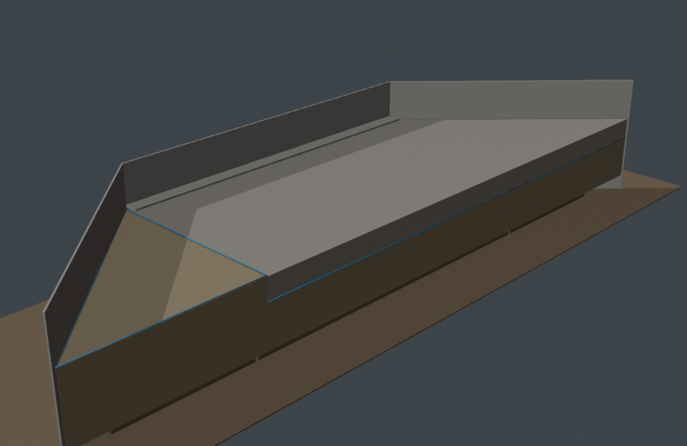
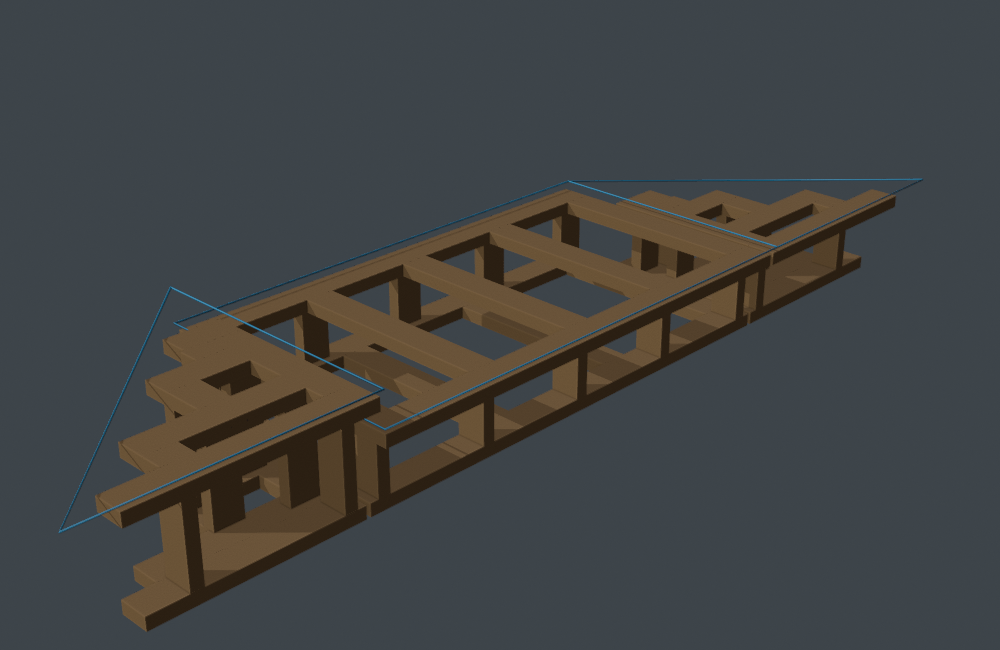

# Bay Window Daybed

Python and Blender tools that turn a parameterized furniture design into a 3D
construction model, dimensions, and woodworking cut lists.



*Rendered from the committed V4 Blender model.*

## From parameters to parts

The V4 generator builds three modules: a raised wood landing on the left, a central
cushioned deck, and a lower right module that continues the cushion. It models
square-cut 2×4 framing separately from plywood and finish objects, and generates
the model and fabrication reports from common parameters.

Geometry checks cover dimensions, fit, clearances, and assembly constraints.
Side-module framing and finished plywood remain **provisional / field verify**:
template the side plywood to the actual room before cutting. Passing geometric
checks is not a structural certification.



## Open or regenerate

Open [bay_daybed_v4.blend](bay_daybed_v4.blend) with Blender 5.2. The saved cameras
include `V4_FINISHED_ISOMETRIC` and `V4_FRAMING_ISOMETRIC`.

To regenerate the model and reports, run Blender from this directory:

```text
blender --background --python bay_daybed_v4_generator.py
```

This overwrites the V4 outputs beside the generator. Use a scratch checkout when
experimenting.

- [V4 generator](bay_daybed_v4_generator.py)
- [V4 cut list](bay_daybed_v4_cutlist.csv)
- [V4 dimensions and construction notes](bay_daybed_v4_dimensions.txt)

Earlier center-module and V3 variants are retained alongside V4. V5 is a design
plan in `docs/`, not an implemented model in this revision.

## Checks

The standalone Python scripts, such as `python test_bay_daybed_v4.py`, invoke
Blender and regenerate artifacts. They currently use a Windows Blender 5.2 install
path. Run them in a disposable checkout. No CI workflow is included.
